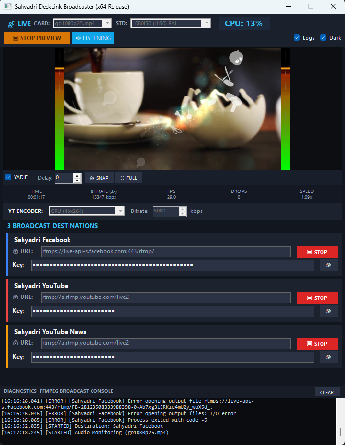

# Channel DeckLink Streamer (.NET 10 x64 Release)



High-performance broadcast streaming desktop application for Windows x64. Ingests a **Blackmagic DeckLink SDI/HDMI source**, a **Live YouTube / Network Stream**, or a **local media loop**, and broadcasts simultaneously to **3 destinations**:
1. **Channel Facebook**
2. **Channel YouTube**
3. **Channel YouTube News**


-purple)


---

## 🌟 Key Features

- **Multi-Source Ingest Flexibility**:
  - **Blackmagic DeckLink Hardware**: Direct SDI/HDMI hardware capture via official DeckLink SDK (`DeckLinkAPI.Interop.dll`). Supports `DeckLink SDI 4K`, `DeckLink Duo (1-4)`, `DeckLink Quad`, and `UltraStudio`. Default broadcast standard: `1080i50 (Hi50)` with real-time YADIF deinterlacing.
  - **🌐 YouTube Live & Network Streams**: Ingest live YouTube streams directly (`https://www.youtube.com/watch?v=...`, `https://youtu.be/...`, `https://youtube.com/live/...`) as well as direct network streams (HLS `.m3u8`, RTSP, RTMP, SRT). Powered by bundled `yt-dlp.exe` with automatic live stream resolution, fault recovery, and dual video/audio manifest alignment.
  - **Local Media Loop**: Test or standby loop playback using local files (e.g. `go1080p25.mp4`).
  - **Audio Monitoring & Sync**: Millisecond sync delay compensation (`Audio Delay: 0 ms`) and real-time audio listen (`🎧 LISTEN`) to route SDI/network audio to headphones or speakers.

- **3 Simultaneous Streaming Destinations**:
  - **Channel Facebook**: `rtmps://live-api-s.facebook.com:443/rtmp/`
  - **Channel YouTube**: `rtmp://a.rtmp.youtube.com/live2`
  - **Channel YouTube News**: `rtmp://a.rtmp.youtube.com/live2`
  - Distributed via high-throughput TCP broadcast hub and FLV streaming runners with fault isolation.
  - Individual destination controls, status badges, and masked stream key inputs with eye reveal toggle.

- **Operator Preview Canvas & Audio VU Meters**:
  - Crisp 16:9 Live Video Monitor.
  - Left & Right Stereo Peak-Hold Audio VU Meters directly beside the video preview.
  - Standby Preview mode to check camera feed and audio levels before pushing live.
  - Fullscreen pop-out monitor (double-click video preview or click `⛶ FULL`).
  - Frame snapshot capture button (`📸 SNAP`).

- **Hardware GPU Acceleration**:
  - **NVIDIA NVENC (`h264_nvenc` & `hevc_nvenc`)**: Zero-latency GPU encoding (`-preset ll -tune ll -zerolatency 1`, 2-second GOP).
  - **AMD AMF** and CPU software fallback (`libx264`).
  - Configurable bitrate (1500 to 30000 kbps).

- **Persistent Settings (Outside Project Folder)**:
  - Settings are stored strictly in `%APPDATA%\DeckLinkStreamStudio\settings.json`.
  - No settings files are written to or maintained within the project directory.

- **Strict 64-Bit Release Build**:
  - Built exclusively for 64-bit Windows in Release mode (`bin\Release\net10.0-windows\win-x64\DeckLinkStreamStudio_*.exe`).
  - Bundled `yt-dlp.exe` resides directly in the output directory beside the main executable.

---

## 🚀 Running the Streamer

Launch the generated Release executable:
```powershell
.\bin\Release\net10.0-windows\win-x64\DeckLinkStreamStudio_*.exe
```

To re-compile the 64-bit Release binary:
```powershell
dotnet build -c Release
```
